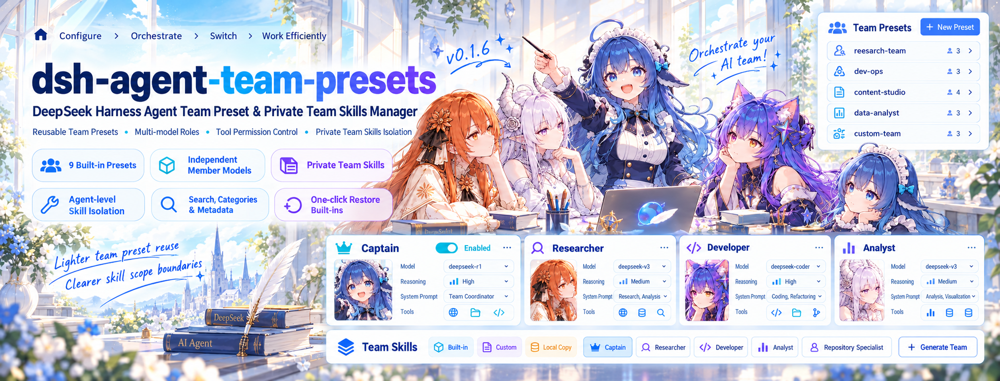

# dsh-agent-team-presets



*Concept illustration. See [Screenshots](#screenshots) for the plugin interface; the captain uses the conversation's selected model.*

English | [中文](<README.zh.md>)

> **Community plugin v0.1.4** · [Release](https://github.com/bloodarea/dsh-agent-team-presets/releases/tag/v0.1.4)
>
> Requires a compatible DeepSeek Harness deployment with Agent Teams enabled. This version uses rc.2 APIs; see [Requirements](#requirements). Prebuilt artifacts are included, so installation does not require a source build.

<a id="project-introduction"></a>
## Overview

**dsh-agent-team-presets** is a visual Team preset manager for [DeepSeek Harness](https://github.com/deepseek-ai/deepseek-harness). Configure a Team once, then select it from the conversation composer whenever you need it.

A Team contains a **captain** and any number of **member roles**:

- The captain uses the conversation's selected model, with its own role description, system prompt, and tool policy.
- Each member can have a different provider, model, reasoning effort, system prompt, and tool policy.
- The captain summons members through `spawn_team_member`; native Agent Teams provides messaging, the shared task board, and runtime coordination.

This is a community plugin, not the Harness's bundled `@deepseek-ai/dsh-experimental-agent-team-presets` development package.

<a id="why-this-plugin"></a>
## Why this plugin?

DeepSeek Harness already ships Agent Teams with multi-agent collaboration. In the Harness versions this plugin supports, per-Team configuration and reuse are still left to the user, which is what this plugin addresses:

- **Teams are hard to reuse.** In those versions, native teams focus on runtime creation and collaboration, with no visual preset management; this plugin saves, duplicates, and reuses named presets.
- **Role setup is repetitive.** Each role's name, description, and system prompt are configured once instead of re-described every time.
- **Splitting work across models is awkward.** Every member picks its own model and reasoning effort, so one Team combines models by task, while the captain keeps leading on the Session's model.
- **Tool permissions have no fine-grained entry point.** In those versions the native tool surface offers no per-role allow-list; here the captain and each member carry their own, so roles differ in what they may use.
- **Switching teams is inconvenient.** Pick a preset Team from the composer instead of rebuilding roles by hand.

**Design principle:** native Agent Teams owns collaboration at runtime; this plugin owns configuring, managing, and reusing teams.

<a id="features"></a>
## Features

- **Reusable Teams:** create, duplicate, edit, select, and delete named presets.
- **Per-member model routes:** assign models and reasoning effort to individual roles without changing the captain's model.
- **Independent tool policies:** choose all available tools or a custom allow-list for the captain and each member.
- **Portable presets:** import and export role definitions while keeping deployment-specific routes and tool permissions local.
- **Built-in starting points:** lightweight, standard, and full-stack software development Teams.
- **Live settings feedback:** see whether a Team is idle, busy, or awaiting an update in an online Session.

## Contents

- [Overview](#project-introduction)
- [Why this plugin?](#why-this-plugin)
- [Features](#features)
- [Screenshots](#screenshots)
- [Requirements](#requirements)
- [Install and upgrade](#use-this-package)
- [Configure and use a Team](#configure-a-team)
- [Share presets](#share-presets)
- [Let the captain edit a preset](#edit-presets-with-tools)
- [Tool permissions and security](#tool-permissions)
- [Troubleshooting and limitations](#known-limitations-and-deferred-work)
- [How it works](#understand-the-implementation)
- [Development and contributing](#development)
- [Related resources](#further-exploration)
- [License](#license)

<a id="screenshots"></a>
## Screenshots

The screenshots illustrate the composer control and settings workflow. Example Team and provider names are illustrative; available models and tools depend on your deployment. Some screenshots show an earlier UI revision, so controls and helper text may differ from v0.1.4. The permission rules below describe the current version.

**Choose a Team in the composer**


**Manage saved Teams**


**Configure member models and reasoning effort**


<details>
<summary>More settings screenshots</summary>

**Team editor**


**Model picker**


**Captain and member system prompts**


**Tool policy controls**


</details>

<a id="requirements"></a>
## Requirements

- **DeepSeek Harness with the required rc.2 APIs.** Several dependencies require `>=0.2.0-rc.2 <0.3.0`, while others have broader peer ranges. The plugin manager checks every declared dependency; the exact requirements are in [package.json](<package.json>). Do not treat rc.1 as sufficient for this release.
- **Agent Teams enabled in the target profile.** The standard integration is `@deepseek-ai/dsh-experimental-agent-team-profile`, which supplies the Team service, tools, and Web roster. This plugin configures Teams; it does not replace that subsystem.
- **A Web or Desktop profile with Settings and the required client services.** Install into the profile you actually use, typically `web` for the Web GUI or `desktop` for Desktop.
- **Durable storage and a continuable subagent backend for member execution.** Member creation is refused if the storage domain or the selected execution backend is unavailable. The default backend names are `spawn` and `fork`; custom deployments must configure compatible backends.

The plugin version (`0.1.4`) and the Harness version (`0.2.0-rc.2`, for example) are separate version lines.

<a id="use-this-package"></a>
## Install and upgrade

### One-click install in the GUI (Add plugin)

No command line required: open **Global panels → Plugins → Add plugin**, paste the line below into **Package name or address**, and click **Install**.

```text
dsh-agent-team-presets@0.1.4
```

<!-- release-version: keep in sync with package.json version -->

- **Registry** selects which npm source the download comes from; **Default registry** and **Official npm registry** both work, and **Mainland China mirror** is there when neither answers.
- `@0.1.4` names the version; drop it and enter `dsh-agent-team-presets` to take whatever npm currently publishes.
- The field takes the same specs as `dsh plugin add`: a package name, `name@version`, `github:owner/repo`, a tarball URL, or an absolute path. The check before installing queries the package, so a version that does not exist or a package without `dsh.bundle` is refused before anything is written.
- This package declares its own `dsh.bundle`, so the plugin manager registers it as a profile bundle layer; do not add a loader entry by hand.
- Once the package is installed the field cannot install it again: the manager matches on package name and reports that it is already installed. To change installation source (for example from `github:…#v0.1.4` to the npm form), uninstall it in the plugin list first, then paste the spec above.
- The plugin manager only installs and enables; reload or restart as it instructs afterwards. Use the npm form when you want later releases to be offered; a pinned-ref source install is compared only with that ref and never advertises a newer one (see below).

### Install from GitHub

For an installation that can receive repository-version update notifications:

```sh
dsh plugin --profile <profile> add github:bloodarea/dsh-agent-team-presets
```

Replace `<profile>` with the profile your GUI runs. For example:

```sh
dsh plugin --profile web add github:bloodarea/dsh-agent-team-presets
```

To select the v0.1.4 release tag instead:

```sh
dsh plugin --profile <profile> add github:bloodarea/dsh-agent-team-presets#v0.1.4
```

An unpinned GitHub install follows the repository's package version for market update checks; commits without a version increase do not produce a new-version notification. A pinned ref is compared only with that ref, so later releases are not offered automatically. Use a commit SHA rather than a tag if you need an immutable source reference.

### npm release channel

GitHub and [npm](https://www.npmjs.com/package/dsh-agent-team-presets) are separate release channels and may not carry the same version. Check npm before installing from it:

```sh
npm view dsh-agent-team-presets version
```

If that version meets your requirements, install it with:

```sh
dsh plugin --profile <profile> add dsh-agent-team-presets
```

If the registry version is older than the release you need, use the GitHub command instead. Installing this package uses the prebuilt artifacts; rebuilding them is a separate [development task](#development).

### Verify and upgrade safely

After a successful installation, follow the plugin manager's reload or restart instructions and open **Settings → Agent team presets**. Check that plugin details show `dsh-agent-team-presets`, the expected version, and a running component.

- Back up the profile, Team definitions, and Session selections before upgrading or changing installation sources.
- A failed command, compatibility rejection, or failed component is not a successful installation. Inspect the error before retrying; repeated restarts do not repair a failed install.
- When switching from a development link, remove `@deepseek-ai/dsh-experimental-agent-team-presets` through the plugin manager before enabling the community package. Do not enable both: they use the same settings namespace and client registrations. Preserve existing Team settings and selections during migration.
- Restart Harness after changing package identities, then refresh the GUI. A page refresh alone may leave the old client module registered in the Host.

> **Install the bundle; do not add a second loader declaration.** The package already supplies its own [bundle patch](<cordis.patch.yml>). Hand-written copies of the `agent-team-presets` entry in profile, home, or command-line patches can prevent Team settings from being saved. See [Configuration writes are overridden](#configuration-overridden) if this happens.

<a id="configure-a-team"></a>
## Configure and use a Team

1. Open **Settings → Agent team presets**.
2. Choose a built-in Team, duplicate one, or create a new Team.
3. Set its purpose, captain, and member roles. Configure member routes and tool permissions for your deployment.
4. Press **Save** in the shared footer. Edits remain a draft until saved.
5. Select the Team from the conversation composer's Team control, then ask the captain to carry out a task with the relevant roles.

For a Team with implementation and review roles, a request could be:

> Use the selected Team. Have the implementation member make the agreed change, then ask the reviewer to check it independently. Summarize the changes, test results, and remaining risks.

A preset role is not an already-running member. Each call creates a new instance with a unique target such as `reviewer` or `reviewer-2`. Use the returned target with `send_message` to continue an existing member instead of creating another one.

Selecting **No team** removes the Team application once the captain and its teammates are idle. It restores the conversation's other prompt and tool contributions, without changing the selected model.

### Fields

| Field | Purpose |
|---|---|
| Team name and purpose | Identify the preset and explain what work it should handle. |
| Captain | The conversation's lead agent. A nonempty captain prompt replaces its persona prefix; the captain keeps the conversation's selected model. |
| Members | Reusable role templates the captain can summon. A role may have multiple runtime instances, subject to Harness limits. |
| Name | Display name. After trimming and lowercasing, ASCII letters/digits separated by single hyphens form a role target if it is at most 64 characters and not `lead`. Other names, including empty or non-Latin names, use a target such as `member-1`; collisions receive suffixes. Runtime messages use the returned instance target. |
| Description | Explain the role's responsibilities so the captain can choose an appropriate member. Keep member descriptions within 200 characters, as required by the Team service. |
| Color | Accent used to distinguish the role in Settings and the roster. |
| Provider / Model | Members only. Select a route from the deployment's model catalog; without a complete provider/model selection, no member-specific route is installed. |
| Reasoning effort | Members only. Options depend on the selected model; empty uses that route's default. |
| Allowed tools | Independent all-tools or custom policy for each slot; see [Tool permissions](#tool-permissions). |
| System prompt | Standing role instructions. Complete `{{variable}}` groups are prompt-template variables; an unresolved variable can fail a request. |

The editor has three levels: the Team list, one Team, and one captain or member. You can return to the list without losing a staged edit, but **Save** is required to persist it.

### Built-in presets

A fresh installation seeds three editable Teams:

| Preset | Intended use |
|---|---|
| 轻量研发团队 | Small features and module iterations, with an implementation member and an on-demand technical advisor. |
| 标准研发团队 | Medium features and significant refactoring, adding an independent reviewer. |
| 全栈软件研发团队 | Work across Web, desktop, and Android, with implementation, architecture, UI/UX, and review roles. |

Their prompts are in Chinese. The same portable documents are available in [contrib/default-presets](<contrib/default-presets>) for manual import.

Defaults are offered once per profile configuration: deleted presets stay deleted across restarts and upgrades, and edited presets are not overwritten. **Restore defaults** restores the shipped fields while preserving routes and tool policies on matched roles, and leaves user-created Teams alone. It also restores each built-in Team's shipped roster, removing roles you added to that Team; duplicate a customized Team first if you want to keep it. Restored presets are staged until you press **Save**. A deleted preset added back has no previous local route or tool policy to preserve.

### When saved changes take effect

A Team preset is shared across Sessions in the profile, but each Session adopts updates independently:

| Change | Effect |
|---|---|
| Purpose, role descriptions, prompts, roster, or tool policies | An idle Session adopts the change immediately. A busy Session keeps its applied definition until the task ends. |
| Team selection, including No team | Takes effect once that Session's captain and teammates are idle. |
| Member provider, model, or reasoning effort | Read when a **new member instance** is summoned, even during a running task. Existing instances retain their creation-time route. |
| Color | Updates when the UI redraws. |

The footer summarizes online Sessions as **idle**, **busy**, or **unknown**. Busy includes a running captain or a running/provisioning teammate. Unknown means execution state could not be confirmed, not that the Team is idle.

<a id="share-presets"></a>
## Share presets

**Export** saves one Team as JSON. **Import preset** reads that document and stages it in the editor.

- Shared fields: Team name and purpose; captain/member names, descriptions, prompts, and colors.
- Local fields: model routes and tool permissions. These are not exported; an import containing them is rejected.
- Name collisions: choose replacement or a renamed addition for the Team and conflicting roles. Replacement preserves matched roles' local routes and tool policies, and keeps members not mentioned in the import.
- New Teams and roles start without a fixed member route and with the default all-tools policy. Review their prompts and permissions before use, especially for documents from others.

Exports include the currently displayed draft, including unsaved edits. Imports do not reach stored settings until you press **Save**. Review prompts for private information before publishing an exported document.

<a id="edit-presets-with-tools"></a>
## Let the captain edit a preset

You can ask the conversation's lead agent to adjust a Team's purpose or role instructions. Two tools are registered on root Sessions, including Sessions with no Team selected, subject to the active tool policy:

- **`get_team_preset`** reads the selected Team, or the Team named by `team_id`, and returns its editable fields and settings revision. Without a selection, it lists configured Teams so you can choose one.
- **`update_team_preset`** changes Team/captain descriptions and captain/member system prompts or member descriptions, using that revision. Names, model routes, colors, and tool permissions must be edited in Settings.

A write requires a direct user-started turn and Host approval of the exact target and changes. If approval is disabled, denied, or unavailable, nothing is saved. Another writer advancing the revision also requires a fresh read before retrying.

The update tool returns **`team-busy`** while any affected online Session has a running or provisioning teammate. Wait for those teammates to finish, then read the revision again. The Settings page can still save changes for later adoption. A successful tool write uses the same adoption timing as a Settings save; it does not rewrite an existing teammate's stored persona or policy.

<a id="tool-permissions"></a>
## Tool permissions and security

### Policy modes

- **Default: all tools** adds no allow-list restriction beyond the deployment's permissions and Team role rules.
- **Custom allowed tools** permits only selected tool names, including scoped Team coordination tools such as `send_message`, `list_agents`, and `team_task_*`. An empty custom list denies all configurable tool calls. Switching modes preserves the saved custom selections.
- Captain and member policies are independent. To coordinate a Team under a custom policy, explicitly allow the tools each role needs; allowing them for the captain does not grant them to members.

The catalog groups tools by this plugin, MCP server, and other tools. Groups offer selection controls and show selected/total counts. Descriptions use the registry's model-facing text and may remain English even when the interface is localized. The catalog combines tools from different Agent presets; a listed tool is not necessarily available to the current Session. Choose an Agent preset that provides it or remove it from the allow-list if application is refused.

Captain-only tools are disabled on member pages. Native `spawn_teammate` is blocked while a Team preset is active; use `spawn_team_member` so member configuration is applied consistently.

### Security boundaries

- The allow-list is **not a filesystem, process, or network sandbox**. An allowed shell, code-capable tool, or third-party plugin may have broad indirect capabilities. Keep Harness's own sandbox and approval settings appropriate for the work.
- Custom mode denies general-purpose `run_code` and ordinary `subagent`, `subagent_fork`, and `workflow` delegation, because those paths do not provide this plugin's durable strict-policy contract. Use preset-managed Team members for delegation.
- Custom policies use native tool calling. If an inherited programmatic tool-calling (PTC) presentation is replaced, Settings discloses the change. If a conflicting presentation is declared on the exact Session scope and cannot be replaced, Team application is refused rather than silently weakening the policy.
- Invalid updates retain the last valid application. If a safe initial application or recovery cannot be established, affected tool execution is blocked until the configuration is corrected or a valid Team/No team selection can take effect.
- Managed members require their durable configuration on resume. Missing or corrupt records are refused rather than replaced by unrestricted defaults. The plugin must remain installed for this protection; it cannot enforce policies after it has been removed.

<a id="known-limitations-and-deferred-work"></a>
## Troubleshooting and limitations

<a id="configuration-overridden"></a>
### Configuration writes are overridden

If saving or selecting a Team reports:

```text
Configuration for "agent-team-presets" is overridden by a home patch or command-line overlay
```

a patch layer conflicts with the settings write. The installed bundle already inserts the plugin entry; a duplicate hand-written declaration or an overriding configuration can prevent the Host's editor from committing changes.

1. Back up the profile, Team definitions, and Session selections.
2. Check the profile patch, `$DSH_HOME/cordis.patch.yml`, and any `--patch` overlays for conflicting hand-written `agent-team-presets` declarations.
3. Remove the conflicting declaration or override. **Do not simply move it into another patch.** Preserve the Host-managed settings row and saved Teams; do not delete every occurrence of the entry indiscriminately.
4. Keep the installed bundle in `dsh.profile.bundles` and edit Teams through Settings.

The composer and Settings page show the Host's error text when a write fails.

<a id="verify-member-model-route"></a>
### A member's displayed model differs from its route

In Harness `0.2.0-rc.2`, the Team roster and `list_agents.model` read creation-time options or fallback metadata, not this plugin's member-scoped request selection. `list_agents.provider` identifies the subagent execution backend, not the LLM provider, and the tool does not report `reasoningEffort`. A display mismatch alone does not establish a routing failure.

- **Check configuration:** `configuredRoute` in the `spawn_team_member` result reports the route captured for that instance. It is omitted when no member-specific route is configured. Advanced diagnostics can also inspect `route` in the durable `agent_team_presets_members` unit.
- **Check request records:** inspect the corresponding member Session's `request/header` or `modelSelection.lastUsed` projection. Before the first request header, `lastUsed` is empty; afterwards it describes the last recorded request, not the next selection.
- **Understand the scope:** a configured value does not prove that a request executed. Request records identify the route used by Harness, not a third-party service's internal model implementation. Self-reported names and throughput are not independent model-identity verification.

### Other common issues

| Symptom | What to check |
|---|---|
| Settings page is absent or the plugin is pending | Confirm the target profile, peer compatibility, Agent Teams, and required client services. |
| Model or tool catalog fails to load | Read the displayed error and check the deployment's provider/tool services. Saving a preset cannot add a missing capability. |
| Member creation is refused | Check durable storage, the configured execution backend, route/effort availability, and Harness depth/concurrency/member limits. A finished member frees an activity slot, not its permanent Team roster slot. |
| A prompt fails with an unknown variable | Correct the `{{variable}}` group or provide the variable through the deployment. |
| Windows configuration cannot be parsed | Preserve valid UTF-8 JSON without a BOM when editing profile manifests. Do not disable schema validation or delete active Host/credential locks to work around an error. |
| The selected Team was deleted | Select a valid Team or No team. A missing Team is an error, not an implicit switch to unrestricted mode. |

### Persistence and compatibility

- Team definitions and Session selections live in profile settings, not a structured selection history in the Session event log. Rendered prompts may contain the Team name, but they do not make the selection portable: a fork or a move to another deployment needs an explicit Team selection and matching settings.
- Already-created members retain their creation-time persona, description, route, and tool policy, including when resumed with `send_message`. Saved preset changes apply to future instances; send an existing member a message to adjust its immediate task.
- Legacy captain route fields are removed during settings reconciliation because captains use the conversation's model. Back up configuration before migrating older profiles.
- The bundled schema runtime in v0.1.4 fixes missing-`zod` startup imports from earlier package builds. It does not repair unrelated Harness installation, encoding, lock, or third-party plugin failures.

<a id="understand-the-implementation"></a>
## How it works

The plugin uses Cordis and Harness extension points without patching the Host:

1. **Profile configuration** stores Team definitions and Session selections. The browser uses revision-checked settings writes and an event-driven execution stream.
2. **Session application** installs the captain's persona/briefing, tool policy, and `spawn_team_member` at the Agent scope. It does not change the root conversation's model selection.
3. **Member creation** validates the route and delegation limits, stores an instance snapshot, and creates the child through a plugin-owned execution-backend alias. The serial `agent/created` lifecycle installs its model route, persona, Team context, and strict tool policy before its first request.
4. **Resume and cleanup** restore a managed member's snapshot and dispose scoped registrations when their owning application ends. Existing members keep their captured configuration rather than adopting later preset edits.

### Source navigation

| Area | Source |
|---|---|
| Plugin lifecycle and settings reconciliation | [index.ts](<src/index.ts>), [settings-reconcile.ts](<src/settings-reconcile.ts>) |
| Team application and member tool | [application.ts](<src/application.ts>) |
| Member snapshots, identity, and resume | [member-store.ts](<src/member-store.ts>), [member-identity.ts](<src/member-identity.ts>), [member-runtime.ts](<src/member-runtime.ts>) |
| Tool policies and presentation | [tool-policy.ts](<src/tool-policy.ts>), [presentation.ts](<src/presentation.ts>) |
| Preset editing and portable documents | [preset-tools.ts](<src/preset-tools.ts>), [preset-transfer.ts](<src/preset-transfer.ts>) |
| Execution state and catalog | [execution.ts](<src/execution.ts>), [tool-catalog.ts](<src/tool-catalog.ts>) |
| Browser UI | [src/client](<src/client>) |

<a id="model-experience"></a>
### Prompt and context behavior

The captain sees its configured persona, the Team purpose, and a roster of member role targets and descriptions. A member sees its own role instructions and the Team's division of labour; that role list is not a live runtime roster. Use `list_agents` for current targets and status.

These prompt sections and the `spawn_team_member` schema add to the model's context. Larger rosters and longer prompts therefore use more tokens. Definitions remain stable during a task, but actual prompt-cache reuse depends on prompt variables and the provider; the plugin makes no cache-hit guarantee. Rendered system prompts are recorded in the Session's `system/message` events.

<a id="dev-note"></a>
<a id="development"></a>
## Development and contributing

Source development requires a compatible, dependency-installed [Harness checkout](https://github.com/deepseek-ai/deepseek-harness). From this repository:

```sh
export DSH_CHECKOUT=/absolute/path/to/deepseek-harness
npm test
npm run typecheck
npm run bundle
```

The scripts use the checkout's tooling and source aliases. Tests use mock model adapters; `npm run typecheck` reports this plugin's diagnostics, not a clean typecheck of the entire Harness. `npm run bundle` rebuilds the committed artifacts in an isolated staging workspace. These checks do not replace visual or real-provider testing. See the scripts in [tools](<tools>) and the [test suite](<tests>) for the current verification scope.

Bug reports and pull requests are welcome in [GitHub Issues](https://github.com/bloodarea/dsh-agent-team-presets/issues) and [Pull requests](https://github.com/bloodarea/dsh-agent-team-presets/pulls). For a report, include:

- Harness and plugin versions, OS, profile type, and installation source/ref.
- Reproduction steps, expected behavior, actual behavior, and relevant error text.
- A minimal, redacted preset or screenshot when helpful.

Do not publish credentials, private endpoints, full Session logs, or proprietary prompt content. Review the affected behavior and add focused tests when changing runtime code. Keep the two README versions and prebuilt artifacts consistent with a release.

<a id="further-exploration"></a>
## Related resources

- [DeepSeek Harness](https://github.com/deepseek-ai/deepseek-harness) — the Host and its plugin system.
- [Built-in preset documents](<contrib/default-presets>) — portable starting points for your own Teams.
- [GitHub Releases](https://github.com/bloodarea/dsh-agent-team-presets/releases) — published versions.

<a id="license"></a>
## License

[MIT](<LICENSE>). Bundled third-party notices are in [THIRD-PARTY-NOTICES.txt](<lib/THIRD-PARTY-NOTICES.txt>).
