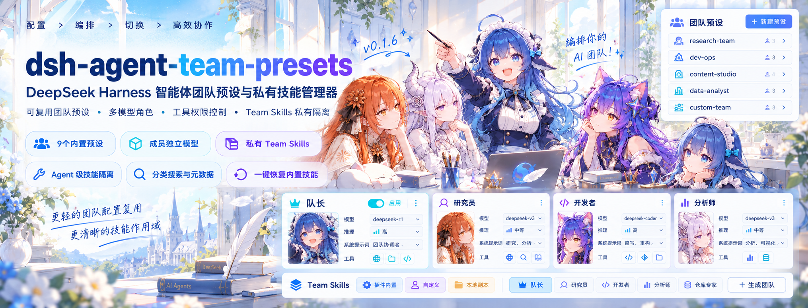

# dsh-agent-team-presets



*横幅为概念示意，实际插件界面见[界面预览](#screenshots)；队长使用当前会话选择的模型。*

[English](<README.md>) | 中文

> **社区插件 v0.1.4** · [发布版本](https://github.com/bloodarea/dsh-agent-team-presets/releases/tag/v0.1.4)
>
> 需要启用 Agent Teams 的兼容 DeepSeek Harness 部署。本版本使用 rc.2 API，详见[环境要求](#requirements)。仓库已包含预构建产物，安装时无需从源码构建。

<a id="project-introduction"></a>
## 项目介绍

**dsh-agent-team-presets** 是面向 [DeepSeek Harness](https://github.com/deepseek-ai/deepseek-harness) 的可视化团队预设管理插件。配置好一套团队后，即可在会话输入区按需选用，无需反复设置角色。

一个团队包含一名**队长**和任意数量的**成员角色**：

- 队长使用当前会话选择的模型，并拥有独立的角色描述、系统提示词和工具策略。
- 每个成员可分别配置提供商、模型、推理强度、系统提示词和工具策略。
- 队长通过 `spawn_team_member` 召唤成员；消息、共享任务板和运行时协作由原生 Agent Teams 提供。

本项目是社区插件，不是 Harness 随附的 `@deepseek-ai/dsh-experimental-agent-team-presets` 开发包。

<a id="why-this-plugin"></a>
## 为什么需要这个插件？

DeepSeek Harness 原生 Agent Teams 已经具备多智能体协作能力。在本插件支持的 Harness 版本中，团队的个性化配置与重复使用仍由用户自己承担，这正是本插件要解决的：

- **团队难以复用**：在这些版本中，原生团队侧重运行时创建与协作，不提供可视化预设管理；本插件可保存、复制并复用具名预设。
- **角色配置繁琐**：每个角色的名称、描述与系统提示词配置一次即可复用，无需每次重新描述。
- **多模型分工不便**：每个成员可独立指定模型与推理强度，一个团队按任务组合不同模型；队长继续使用会话已选模型。
- **工具权限缺乏细粒度入口**：在这些版本中，原生工具面没有按角色设置的白名单；本插件让队长与每个成员各带自己的白名单，不同角色的可用范围因此不同。
- **切换团队不便**：在会话输入区直接选择预设团队，不必手工重建角色。

**核心理念：** 原生 Agent Teams 负责运行时协作；本插件负责团队的配置、管理与复用。

<a id="features"></a>
## 主要功能

- **复用团队：** 新建、复制、编辑、选择和删除具名预设。
- **成员独立路由：** 按角色分配模型与推理强度，不改变队长的模型。
- **独立工具策略：** 为队长和各成员选择所有可用工具，或设置自定义白名单。
- **分享预设：** 导入、导出角色定义，部署相关的模型路由和工具权限保留在本地。
- **内置起点：** 提供轻量、标准和全栈软件研发团队。
- **实时设置反馈：** 查看在线会话中的团队是空闲、忙碌，还是有修改等待采用。

## 目录

- [项目介绍](#project-introduction)
- [为什么需要这个插件？](#why-this-plugin)
- [主要功能](#features)
- [界面预览](#screenshots)
- [环境要求](#requirements)
- [安装与升级](#use-this-package)
- [配置与使用团队](#configure-a-team)
- [分享预设](#share-presets)
- [让队长修改预设](#edit-presets-with-tools)
- [工具权限与安全边界](#tool-permissions)
- [排障与使用限制](#known-limitations-and-deferred-work)
- [工作原理](#understand-the-implementation)
- [开发与贡献](#development)
- [相关资源](#further-exploration)
- [许可证](#license)

<a id="screenshots"></a>
## 界面预览

以下截图展示会话输入区的团队控件和设置流程。团队与提供商名称仅作示例，实际模型和工具取决于你的部署。部分截图来自较早的界面版本，控件和辅助文案可能与 v0.1.4 不同；当前权限行为以下文说明为准。

**在会话输入区选择团队**


**管理已保存的团队**


**配置成员模型与推理强度**


<details>
<summary>更多设置截图</summary>

**团队编辑页**


**模型选择器**


**队长与成员系统提示词**


**工具策略控件**


</details>

<a id="requirements"></a>
## 环境要求

- **具备所需 rc.2 API 的 DeepSeek Harness。** 部分依赖要求 `>=0.2.0-rc.2 <0.3.0`，其他依赖的 peer 范围可能更宽。插件管理器会逐项检查声明的依赖，准确要求见 [package.json](<package.json>)。不要把 rc.1 视为本版本的充分条件。
- **目标 profile 已启用 Agent Teams。** 标准集成是 `@deepseek-ai/dsh-experimental-agent-team-profile`，提供团队服务、工具和 Web 名册。本插件负责配置团队，不替代该子系统。
- **具备 Settings 与所需客户端服务的 Web 或 Desktop profile。** 安装到实际使用的 profile：Web GUI 通常为 `web`，Desktop 通常为 `desktop`。
- **成员执行所需的持久存储与支持恢复执行的子智能体后端。** 缺少 storage domain 或所选执行后端时，插件会拒绝创建成员。默认后端名为 `spawn` 和 `fork`，自定义部署须提供兼容后端。

插件版本（如 `0.1.4`）和 Harness 版本（如 `0.2.0-rc.2`）是不同的版本线。

<a id="use-this-package"></a>
## 安装与升级

### 从 GitHub 安装

需要接收仓库新版本更新提示时，使用不固定 ref 的安装方式：

```sh
dsh plugin --profile <profile> add github:bloodarea/dsh-agent-team-presets
```

将 `<profile>` 替换为 GUI 实际运行的 profile。例如：

```sh
dsh plugin --profile web add github:bloodarea/dsh-agent-team-presets
```

需要选择 v0.1.4 发布标签时：

```sh
dsh plugin --profile <profile> add github:bloodarea/dsh-agent-team-presets#v0.1.4
```

不固定 ref 的 GitHub 安装按仓库包版本检查市场更新，未提升版本号的提交不会产生新版本提示。固定 ref 的安装只与该 ref 比较，不会自动提示后续版本。需要不可变的源码引用时，应固定 commit SHA，而不是可能被移动的标签。

### npm 发布渠道

GitHub 与 [npm](https://www.npmjs.com/package/dsh-agent-team-presets) 是独立发布渠道，版本可能不同。从 npm 安装前先确认版本：

```sh
npm view dsh-agent-team-presets version
```

确认该版本符合要求后，再安装：

```sh
dsh plugin --profile <profile> add dsh-agent-team-presets
```

若 registry 版本低于所需版本，请改用 GitHub 安装命令。安装使用随包提供的预构建产物；重新构建属于单独的[开发工作](#development)。

### 确认安装并安全升级

安装成功后，按插件管理器的提示重新加载或重启，打开 **设置 → 智能体团队预设**。确认插件详情显示 `dsh-agent-team-presets`、预期版本，且组件正在运行。

- 升级或切换安装来源前，备份 profile、团队定义与会话选择记录。
- 命令失败、兼容性拒绝或组件启动失败均不代表安装成功。先查看错误，再决定是否重试；反复重启不能修复失败的安装。
- 从开发链接迁移时，先通过插件管理器移除 `@deepseek-ai/dsh-experimental-agent-team-presets`，再启用社区包。不要同时启用两者，它们使用相同的设置命名空间与客户端注册。迁移时保留既有团队设置和会话选择记录。
- 切换包身份后重启 Harness，再刷新 GUI。仅刷新页面可能仍在宿主中保留旧客户端模块。

> **安装 bundle，不要再声明一份 loader 条目。** 本包已经提供[自己的 bundle patch](<cordis.patch.yml>)。在 profile、home 或命令行 patch 中手写另一份 `agent-team-presets` 条目，可能导致团队设置无法保存。遇到此问题请参阅[配置写入被覆盖](#configuration-overridden)。

<a id="configure-a-team"></a>
## 配置与使用团队

1. 打开 **设置 → 智能体团队预设**。
2. 选择内置团队、复制已有团队，或新建团队。
3. 设置团队用途、队长和成员角色，按当前部署配置成员路由与工具权限。
4. 点击共享页脚中的 **保存**。保存前的修改只是草稿。
5. 在会话输入区的团队控件中选中该团队，再要求队长使用相应角色完成任务。

对于包含实现与审查角色的团队，可以这样提出任务：

> 使用当前团队，让研发执行者完成约定改动，再让审查员独立检查。最后汇总改动、测试结果和剩余风险。

预设角色不等于已经运行的成员。每次召唤会创建一个新实例，使用 `reviewer`、`reviewer-2` 等唯一 target。需要继续已有成员的工作时，应通过 `send_message` 向返回的 target 发消息，而不是再次创建实例。

选择 **不使用团队（No team）** 后，会在队长及成员全部空闲时移除团队应用，恢复会话其他提示词与工具贡献，不改变当前选择的模型。

### 字段说明

| 字段 | 用途 |
|---|---|
| 团队名称与用途 | 标识预设，并说明适合处理什么工作。 |
| 队长 | 当前会话的主智能体。非空的队长提示词会替换其 persona 前缀；队长继续使用会话选择的模型。 |
| 成员 | 队长可召唤的角色模板。在 Harness 限额内，一个角色可创建多个运行时实例。 |
| 名称 | 显示名称。去除首尾空格并转为小写后，由 ASCII 字母/数字及单个连字符分隔、长度不超过 64 字符且不是 `lead` 的名称，可作为角色 target。其他名称（包括空名称和中文名）使用 `member-1` 等生成标识，重名时添加后缀；运行时消息使用工具返回的实例 target。 |
| 描述 | 说明角色职责，帮助队长选择合适的成员。成员描述应遵守 Team 服务的 200 字符上限。 |
| 颜色 | 在设置页和名册中区分角色的强调色。 |
| 提供商 / 模型 | 仅成员可配置。从部署的模型目录选择路由；未完整选择提供商和模型时，不安装成员独立路由。 |
| 推理强度 | 仅成员可配置。选项取决于所选模型，留空使用该路由的默认值。 |
| 允许的工具 | 为各角色独立设置所有工具或自定义策略，详见[工具权限](#tool-permissions)。 |
| 系统提示词 | 固定的角色指令。完整的 `{{variable}}` 组会作为提示词模板变量处理，未能解析的变量可能导致请求失败。 |

编辑器分为团队列表、单个团队、单个队长或成员三个层级。返回列表不会丢失暂存修改，但必须点击 **保存** 才会持久化。

### 内置预设

全新安装会初始化三个可编辑的团队：

| 预设 | 适用场景 |
|---|---|
| 轻量研发团队 | 小型功能与模块迭代，包含研发执行者和按需参与的技术顾问。 |
| 标准研发团队 | 中型功能与重要重构，增加独立审查角色。 |
| 全栈软件研发团队 | 跨 Web、桌面和 Android 的工作，包含实现、架构、UI/UX 和审查角色。 |

这些预设的提示词使用中文。同样的可分享文档保存在 [contrib/default-presets](<contrib/default-presets>)，可手动导入。

默认预设在每份 profile 配置中只提供一次：删除后不会因重启或升级自动恢复，修改后的预设也不会被覆盖。**恢复默认预设** 会恢复随插件提供的字段，保留匹配角色的路由与工具策略，不影响用户自建团队。同时会恢复各内置团队原有的成员名单，移除你向该团队追加的角色；如需保留自定义版本，应先复制团队。恢复结果先进入草稿，点击 **保存** 后生效。重新加入的已删除预设没有旧的本地路由或工具策略可供保留。

### 保存后何时生效

同一 profile 中的会话共享团队预设，但分别采用更新：

| 修改 | 生效时机 |
|---|---|
| 团队用途、角色描述、提示词、成员名单或工具策略 | 空闲会话立即采用；忙碌会话保留已应用的定义，直到当前任务结束。 |
| 团队选择，包括不使用团队 | 该会话的队长及成员全部空闲后生效。 |
| 成员提供商、模型或推理强度 | 召唤**新成员实例**时读取，进行中的任务同样适用；已有实例保留创建时路由。 |
| 颜色 | 界面重绘时更新。 |

页脚以 **idle（空闲）**、**busy（忙碌）** 或 **unknown（未知）** 汇总在线会话状态。队长运行中，或成员运行中/创建中，均视为忙碌。未知表示无法确认执行状态，不代表团队空闲。

<a id="share-presets"></a>
## 分享预设

**导出** 将一个团队保存为 JSON；**导入预设** 读取文档并暂存到编辑器中。

- 分享的字段：团队名称与用途，以及队长和成员的名称、描述、提示词、颜色。
- 本地字段：模型路由与工具权限。导出时不包含这些字段，携带这些字段的导入文档会被拒绝。
- 名称冲突：为团队和冲突角色选择替换或改名新增。替换保留匹配角色的本地路由与工具策略，也保留导入文档未提及的成员。
- 新团队和新角色默认没有固定的成员路由，工具策略为默认所有工具。使用前应检查提示词与权限，尤其是来自他人的文档。

导出包含当前显示的草稿，包括尚未保存的修改。导入后只有点击 **保存** 才会写入设置。公开分享前，请检查提示词中是否包含私密信息。

<a id="edit-presets-with-tools"></a>
## 让队长修改预设

可以要求会话的主智能体调整团队用途或角色指令。根会话会注册两个工具，即使未选择团队也能用于查找预设，但仍受当前工具策略限制：

- **`get_team_preset`** 读取当前选择的团队，或 `team_id` 指定的团队，返回可编辑字段与设置修订号。未选择团队时列出已配置团队，供你确认目标。
- **`update_team_preset`** 使用该修订号，修改团队/队长描述、队长/成员系统提示词或成员描述。名称、模型路由、颜色和工具权限须在设置中修改。

写入要求用户直接发起的回合，并由 Host 对具体目标与改动审批。审批禁用、拒绝或不可用时不保存。若其他写入者已推进修订号，也须重新读取后再尝试。

任一受影响的在线会话仍有运行中或创建中的成员时，更新工具返回 **`team-busy`**。等待这些成员结束后，再读取修订号。设置页仍可保存供稍后采用的修改。工具成功写入遵循与设置页相同的采用时机，不会改写已有成员保存的 persona 或工具策略。

<a id="tool-permissions"></a>
## 工具权限与安全边界

### 策略模式

- **默认所有工具**：在部署权限和团队角色规则之外，不增加白名单限制。
- **自定义可用工具**：只允许选中的工具名，作用域内的团队协作工具（如 `send_message`、`list_agents`、`team_task_*`）也须选中。自定义列表为空时，拒绝所有可配置工具调用。切换模式会保留已保存的自定义选择。
- 队长与成员的策略相互独立。使用自定义策略时，应为各角色明确选择所需协作工具；允许队长使用不等于授权成员使用。

工具目录按本插件、MCP 服务器和其他工具分组，各组提供选择操作并显示已选/总数。工具描述沿用注册表中面向模型的文案，因此即使界面已本地化，描述仍可能是英文。目录汇总不同 Agent 预设提供的工具，不代表当前会话全部可用。若应用被拒绝，应选择提供该能力的 Agent 预设，或从白名单移除相应工具。

仅队长可用的工具在成员页面禁用。团队预设启用期间，原生 `spawn_teammate` 被阻止；应使用 `spawn_team_member`，以确保成员配置完整应用。

### 安全边界

- 白名单**不是文件系统、进程或网络沙箱**。允许 shell、具有代码执行能力的工具或第三方插件，可能同时允许其广泛的间接能力。应根据任务设置 Harness 自身的沙箱与审批策略。
- 自定义模式禁止通用 `run_code`，以及普通 `subagent`、`subagent_fork`、`workflow` 委派，因为这些路径不提供本插件的持久严格策略约束。需要委派时使用预设管理的团队成员。
- 自定义策略使用原生工具调用。覆盖继承的程序化工具调用（PTC）呈现方式时，设置页会说明；若当前会话的精确作用域声明了无法替换的冲突呈现方式，则拒绝应用团队，而不是静默放宽策略。
- 无效更新会保留上一份有效应用。若无法建立安全的首次应用或恢复状态，会阻止受影响的工具执行，直到配置得到修正，或有效团队/不使用团队的选择可以生效。
- 受管成员恢复时必须能读取其持久配置。记录缺失或损坏时会拒绝恢复，不会改用不受限的默认配置。该保护要求插件仍然安装；移除插件后，插件无法继续执行策略。

<a id="known-limitations-and-deferred-work"></a>
## 排障与使用限制

<a id="configuration-overridden"></a>
### 配置写入被覆盖

若保存或选择团队时报：

```text
Configuration for "agent-team-presets" is overridden by a home patch or command-line overlay
```

说明某个 patch 层与设置写入冲突。已安装的 bundle 本身会插入插件条目；重复手写声明或覆盖配置可能让宿主编辑器无法提交修改。

1. 备份 profile、团队定义与会话选择记录。
2. 检查 profile patch、`$DSH_HOME/cordis.patch.yml` 和 `--patch` overlay 中有无冲突的手写 `agent-team-presets` 声明。
3. 移除冲突声明或覆盖配置，**不要只是搬到另一份 patch**。保留 Host 管理的设置行和已保存的团队，不要不加区分地删除所有同名条目。
4. 保留 `dsh.profile.bundles` 中已安装的 bundle，通过设置页编辑团队。

写入失败时，会话输入区和设置页会显示宿主的错误信息。

<a id="verify-member-model-route"></a>
### 成员显示的模型与路由不一致

在 Harness `0.2.0-rc.2` 中，Team 名册与 `list_agents.model` 读取创建时选项或回退元数据，而不是本插件安装的成员作用域请求选择。`list_agents.provider` 表示 subagent 执行后端，并非 LLM 提供商，工具也不返回 `reasoningEffort`。仅凭显示不一致，不能判定路由失败。

- **查看配置：** `spawn_team_member` 返回的 `configuredRoute` 表示为该实例保存的路由，未配置成员独立路由时省略。高级诊断也可检查持久成员单元 `agent_team_presets_members` 中的 `route`。
- **查看请求记录：** 检查对应成员会话的 `request/header` 或 `modelSelection.lastUsed` 投影。首次请求头记录前 `lastUsed` 为空；此后表示最近一次已记录请求，而不是下一次选择。
- **判断范围：** 配置值不能证明请求已经执行。请求记录反映 Harness 使用的路由，而不验证第三方服务内部的模型实现。成员自报名称和吞吐速度也不能独立验证模型身份。

### 其他常见问题

| 现象 | 排查方向 |
|---|---|
| 看不到设置页，或插件一直处于等待状态 | 确认目标 profile、peer 兼容性、Agent Teams 和所需客户端服务。 |
| 模型或工具目录加载失败 | 查看页面错误，检查部署的提供商/工具服务；保存预设不能补充缺失的能力。 |
| 创建成员被拒绝 | 检查持久存储、执行后端、路由/推理强度可用性，以及 Harness 的深度、并发和成员数限制。成员结束会释放活动槽位，但不会释放永久团队名册名额。 |
| 提示词因未知变量而失败 | 修正 `{{variable}}` 组，或在部署中提供该变量。 |
| Windows 配置无法解析 | 手工编辑 profile manifest 时使用有效、不带 BOM 的 UTF-8 JSON。不要通过关闭校验或删除活动中的 Host/凭据锁来规避错误。 |
| 已选择的团队被删除 | 选择有效团队或不使用团队。缺失团队是错误状态，不会隐式切换为不受限模式。 |

### 持久化与兼容性

- 团队定义和会话选择存储在 profile 设置中，而不是会话事件日志中的结构化选择历史。渲染后的提示词可能包含团队名称，但不能据此迁移选择；fork 或迁移到其他部署时，仍须明确选择团队并具备相应设置。
- 已创建成员保留创建时的 persona、描述、路由和工具策略，通过 `send_message` 恢复时也不变。预设更新用于未来实例；可向已有成员发消息调整当前任务。
- 设置协调会移除旧版队长路由字段，因为队长使用会话模型。迁移旧 profile 前应备份配置。
- v0.1.4 将 schema 运行时代码内联，修复早期构建缺少 `zod` 导致的启动导入失败；不修复无关的 Harness 安装、编码、锁或第三方插件故障。

<a id="understand-the-implementation"></a>
## 工作原理

插件通过 Cordis 和 Harness 扩展点工作，无需修改宿主源码：

1. **Profile 配置**保存团队定义与会话选择。浏览器通过带修订号校验的设置写入和事件驱动状态流与宿主同步。
2. **会话应用**在 Agent 作用域安装队长 persona/团队简报、工具策略和 `spawn_team_member`，不改变根会话的模型选择。
3. **成员创建**先校验路由与委派限制、保存实例快照，再通过插件专属的执行后端别名创建子会话。串行 `agent/created` 生命周期在首次请求前安装模型路由、persona、团队上下文与严格工具策略。
4. **恢复与清理**重载受管成员的快照，并在所属应用结束时释放作用域注册。已有成员保留创建时配置，不追随之后的预设编辑。

### 源码导航

| 范围 | 源码 |
|---|---|
| 插件生命周期与设置协调 | [index.ts](<src/index.ts>)、[settings-reconcile.ts](<src/settings-reconcile.ts>) |
| 团队应用与成员工具 | [application.ts](<src/application.ts>) |
| 成员快照、身份与恢复 | [member-store.ts](<src/member-store.ts>)、[member-identity.ts](<src/member-identity.ts>)、[member-runtime.ts](<src/member-runtime.ts>) |
| 工具策略与呈现方式 | [tool-policy.ts](<src/tool-policy.ts>)、[presentation.ts](<src/presentation.ts>) |
| 预设编辑与分享文档 | [preset-tools.ts](<src/preset-tools.ts>)、[preset-transfer.ts](<src/preset-transfer.ts>) |
| 执行状态与目录 | [execution.ts](<src/execution.ts>)、[tool-catalog.ts](<src/tool-catalog.ts>) |
| 浏览器界面 | [src/client](<src/client>) |

<a id="model-experience"></a>
### 提示词与上下文行为

队长会看到自己的 persona、团队用途，以及包含成员角色 target 和描述的名单。成员会看到自己的角色指令与团队分工；角色名单不是运行时实时名册，当前 target 与状态应通过 `list_agents` 获取。

这些提示词区段与 `spawn_team_member` schema 会增加模型上下文，更多成员和更长提示词会消耗更多 token。团队定义在任务期间保持稳定，但实际提示词缓存复用取决于变量和提供商，插件不保证缓存命中。渲染后的系统提示词记录在会话的 `system/message` 事件中。

<a id="dev-note"></a>
<a id="development"></a>
## 开发与贡献

源码开发需要一份兼容、已安装依赖的 [Harness 源码](https://github.com/deepseek-ai/deepseek-harness)。在本仓库执行：

```sh
export DSH_CHECKOUT=/absolute/path/to/deepseek-harness
npm test
npm run typecheck
npm run bundle
```

脚本使用所选 Harness 的工具与源码别名。测试使用模拟模型适配器；`npm run typecheck` 报告本插件的诊断，不代表整个 Harness 类型检查通过。`npm run bundle` 在隔离的暂存工作区重建提交到仓库的产物。这些检查不能替代视觉或真实提供商测试。当前验证范围可查看 [tools](<tools>) 中的脚本与[测试套件](<tests>)。

欢迎通过 [GitHub Issues](https://github.com/bloodarea/dsh-agent-team-presets/issues) 和 [Pull requests](https://github.com/bloodarea/dsh-agent-team-presets/pulls) 反馈问题与贡献修改。问题报告请包含：

- Harness 与插件版本、操作系统、profile 类型、安装来源及 ref。
- 复现步骤、预期结果、实际结果和相关错误信息。
- 必要时提供最小化、已脱敏的预设或截图。

不要公开凭据、私有端点、完整会话日志或专有提示词内容。修改运行时代码时，应检查相关行为并补充针对性测试；发布时保持两份 README 与预构建产物一致。

<a id="further-exploration"></a>
## 相关资源

- [DeepSeek Harness](https://github.com/deepseek-ai/deepseek-harness) —— 宿主与插件系统。
- [内置预设文档](<contrib/default-presets>) —— 用于定制团队的可分享起点。
- [GitHub Releases](https://github.com/bloodarea/dsh-agent-team-presets/releases) —— 已发布版本。

<a id="license"></a>
## 许可证

[MIT](<LICENSE>)。随包提供的第三方许可见 [THIRD-PARTY-NOTICES.txt](<lib/THIRD-PARTY-NOTICES.txt>)。
